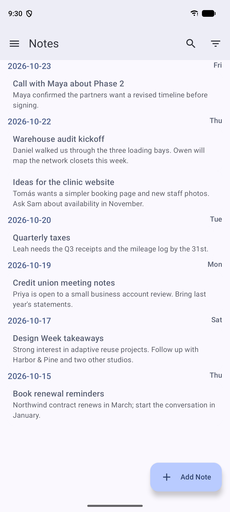
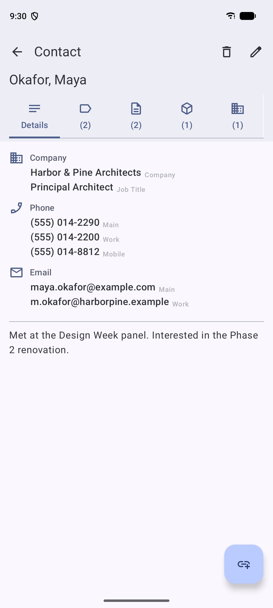
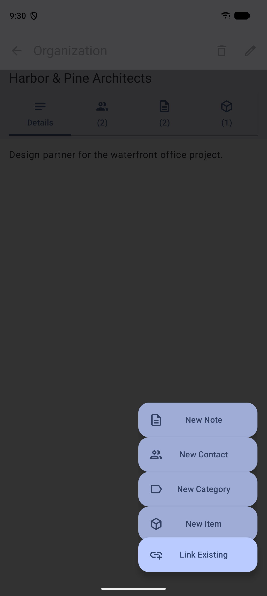

# Gnoseis
Gnoseis is a high performance Android native CRM application that can be also used as an all-purpose knowledge manager. It stores all data securely on device and in future will allow secure cloud-free synchronization.

<p align="center">
  
  &nbsp;
  
  &nbsp;
  
</p>

## Features

- **Five kinds of records**: contacts, organizations, notes, categories and items.
- **Contacts**: first and last name, job title, company, main, mobile, home and work phone numbers and email addresses, and free-form comments. The list is sorted A–Z with letter headings.
- **Notes**: a title and text. The list shows the newest first, grouped by the day they were written.
- **Organizations, categories and items**: a name and comments, for companies, tags such as "Clients" or "Follow-up", and things you want to keep track of.
- **Link anything to anything**: connect a note to the people, organizations, categories and items it is about. Each record's page has a tab for every type of linked record, with a count, so you can go from a contact to their notes, or from a category to everything in it.
- **Create linked records in one step**: from any record, add a new linked note, contact, category or item, or search for an existing record to link.
- **Search** across all record types by name or title.
- **Backup and restore**: export the whole database to a file in a location you choose, and import it again later or on another device. Import checks that the file is a valid Gnoseis backup, upgrades backups from older versions, and leaves your data untouched if anything is wrong. Backup files are not encrypted yet, so keep them somewhere safe.
- **Private by design**: all data stays on your device. The app has no internet permission, and Android cloud backup and device-to-device transfer are turned off for its data.

## Roadmap
The next couple releases are planned using Milestones. To track progress see [here](https://github.com/boredace/Gnoseis-Android/milestones?direction=asc&sort=title&state=open).

## Download

Gnoseis needs Android 10 or later.

Signed APKs are attached to each [GitHub release](https://github.com/boredace/Gnoseis-Android/releases). To check that an APK is genuine, compare its signing certificate with this SHA-256 fingerprint:

```
SHA-256: FA:F6:85:2E:31:BF:F2:DA:5C:1E:92:85:55:E7:71:F5:D4:C1:34:0E:C5:6D:E1:E9:6B:C3:44:53:11:E4:05:4C
```

You can read it with `apksigner verify --print-certs <apk>`.

Copies from different sources (GitHub, and later Google Play and F-Droid) are signed with different keys, so one can't update another. To switch, export a backup in the app, uninstall, install the new copy, then import the backup.

## Building

You need the Android SDK and Java 17 to 22 (Java 21 is tested). Gradle 8.9 can't run on the Java 25 that comes with recent Android Studio versions, so point `JAVA_HOME` at a Java 21 installation. To build a debug APK:

```
./gradlew assembleDebug
```

The APK is written to `app/build/outputs/apk/debug/`. Debug builds use the package name `org.gnoseis.debug`, so they install next to a release build. Release builds need a signing key; see [RELEASING.md](RELEASING.md). Contribution rules are in [CONTRIBUTING.md](CONTRIBUTING.md).

## Licensing

Gnoseis is dual-licensed:

1. **Open-Source License**: Available under the [GNU General Public License v3.0](LICENSE). This allows you to use, modify, and distribute the software freely in open-source projects.
2. **Commercial License**: For proprietary, closed-source, or commercial use, a commercial license is required. See [COMMERCIAL_LICENSE](COMMERCIAL_LICENSE). This file includes contact information.

By contributing to this project, you agree to license your contributions under both licenses.

The screenshots show fictional sample data.
